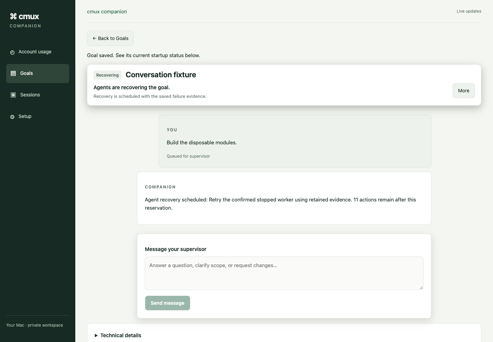
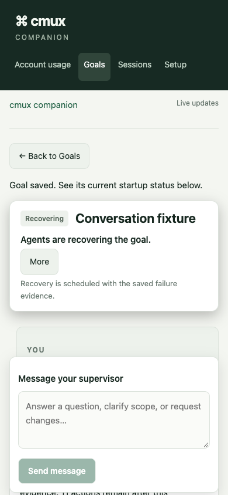

# Agent-led recovery delivery evidence

Date: 2026-10-13. Branch: `feat/agent-led-goal-recovery`.
Contract: [approved specification](superpowers/specs/2026-10-13-agent-led-goal-recovery.md).
Spec commit `782785a7` was reviewed by the user before plan commit `e45ef4ef`.

## Result

New conversational goals reserve and perform routine recovery automatically.
The supervisor selects a changed strategy after repeated unchanged failures.
Goal-wide and per-work budgets, reservations and delays survive restart. Worker
check repairs share that budget instead of receiving a fresh allowance on every
replacement. Existing goals retain their policy until explicitly adopted.

The UI distinguishes recovery, reconciliation and human blockers. It retains the
failure evidence, decisions and spending in technical details, and suppresses
attention notifications while recovery can proceed. Plan and exact-head PR
publication approval remain human-only.

No installed service, existing user goal, external account, credential, merge or
deployment was changed. All execution evidence below uses disposable repositories
and scripted external adapters. Native-provider acceptance remains outstanding.

## Acceptance evidence

| Contract | Evidence | Result |
| --- | --- | --- |
| A1: stopped roles and retained results | Expanded real-service `orchestration-conversation.cy.ts` stops a supervisor and reviewer, injects an implementer launch failure, then reaches verified publication readiness with no recovery click. Domain and reconciler tests retain accepted sibling results. | Passed, scripted adapters |
| A2: mixed failures and exact-head repair | `orchestration-worker-checks.test.mjs` exercises a real failing Git checkpoint, combines check and stopped-worker evidence, and has the supervisor choose reconstruction. Recovery journey/conflict suites independently verify reviewed integrated heads before publication. | Passed |
| A3: agent decisions within authority | `orchestration-agent-recovery.test.mjs`, conversation/bridge regressions and role prompts cover changed strategies, rejected plans, user-only budgets and approval. | Passed |
| A4: crash and uncertain ownership | `orchestration-agent-recovery-crash.test.mjs` uses SIGKILL after reservation, application and launch send; two restarts retain one charge, one replacement and one capacity slot. Existing reconciliation/result/publication crash suites remain enabled. | Passed |
| A5: durable bounds and delays | Recovery domain/fake-clock reconciler tests cover 5/15/45-second delay, episode/goal limits, unchanged failures, diagnosis charges, replacement and restart. | Passed |
| A6: actionable blockers | Recovery/decision projection tests cover setup codes, unclassified failures, unsettled ownership, external uncertainty and exhausted budgets. Historical failures are classified only from their original native operation identity. | Passed |
| A7: recovery presentation | `ui-agent-recovery.test.tsx` checks Active versus Needs you and explicit budget actions. Chrome Cypress checks the real service and keyboard focus; inspected recovery screenshots are 1440×1000 and 390×844. | Passed |
| A8: explicit adoption and history | Original goals remain manual until adoption. The real-Git conflict journey adopts a stopped legacy goal, preserving its approved revision. Domain tests charge historical repairs and repeated attempts conservatively, retaining spending after budget extensions. | Passed |
| A9: control/security boundaries | API tests exercise pairing, same origin, read-only, stale versions and rejection of agent budget changes. Recovery tests fence already-reserved work on pause/abort; Cypress preserves queued steering through reload. | Passed |
| A10: publication evidence and authority | Real-Git journeys stop at the unapproved publication gate with independent review and passing checks on the integration SHA; existing publication regressions and Cypress fake publication remain intact. | Passed |
| A11: actual native launchers | Paid xclaude/xcodex recovery and native session-continuity trials were not run. Deterministic native adapter tests are separate evidence. | Unverified; explicit authorization required |

## Representative outcomes

| Scenario | Recovery clicks | Retained evidence |
| --- | --- | --- |
| Stopped reviewer | 0 | Browser journey; confirmed stopped attempt, charged replacement and subsequent accepted review |
| Stopped supervisor / implementer launch failure | 0 | Same browser journey; conversation survives two supervisor attempts, implementer replacement uses the approved task |
| Rejected plan | 0 | Real-service/Git journey; 3 total recovery actions including later check repairs, revised plan still awaits user approval |
| Failed check | 0 | Real-service/Git review/check journey; 2 recovery actions, passing final checks and accepted independent review on one SHA |
| Integration conflict | 0 | Adopted legacy real-Git journey; 1 recovery action, verified conflict repair and unchanged approved revision |

The combined browser journey recorded five charged actions and zero manual
recoveries. It explicitly approved a fake PR and then aborted for cleanup; its
final `aborted` fixture state is not a claimed merge or native completion.

## Verification and interventions

- Final `npm run verify`: passed; backend 1,194 passed and one pre-existing skip,
  97.72% line coverage; UI 257 passed across 28 files, 95.56% line coverage;
  lint, types and production build passed.
- Final targeted recovery/worker-check run: 31 passed, zero failures.
- `npm run test:mac`: 105 passed, using deterministic local fixtures.
- `CMUX_COMPANION_CYPRESS_BROWSER=chrome npm run test:e2e:local -- --orchestration --spec cypress/e2e/orchestration-conversation.cy.ts`: passed, six screenshots.
- `git diff --check`: passed.

Failures investigated during development:

1. Seven backend expectations assumed the previous manual/immediate retry policy.
   Updated the affected behavior assertions; retained absent-policy compatibility
   coverage and charged worker-local check repairs to the shared budget.
2. Type checks caught optional-value narrowing and a Cypress chain return type;
   both were corrected without relaxing compiler settings.
3. The real-service rejected-plan journey stalled because agent status omitted
   saved revision guidance. Projected `planningRequest` so the standing supervisor
   can act on an automatic revision without another user message.
4. Expanded Cypress encountered a real expected-version race with the supervisor's
   final acknowledgement. The fixture now waits for its saved idle state before
   approving; application stale-approval rejection was preserved. It also waits
   for both replacement workers before inspecting launch counts.
5. The mixed-check fixture initially waited for recovery without supplying the
   required changed agent strategy. It now drives that scoped supervisor command
   and checks that the mixed hold is retained in the automatic recovery receipt.

No coverage threshold was lowered. The ordinary backend suite's pre-existing
skipped path remains explicitly reported by the runner. Full logs and raw browser
evidence are local generated artifacts under `coverage/` and `cypress/results/`;
the committed screenshots below preserve the reviewed recovery presentation.

## Reviewed screenshots

## Remaining boundary

Keep the PR in draft until required native evidence and external review are
complete. The native trial would use isolated disposable goals and owned cmux
sessions through the configured CCS launchers. It requires separate authorization
under [AGENTS.md](../AGENTS.md) and the [native adapter runbook](orchestration-native-adapters.md).
The scripted results establish service behavior, not real-provider reliability.
