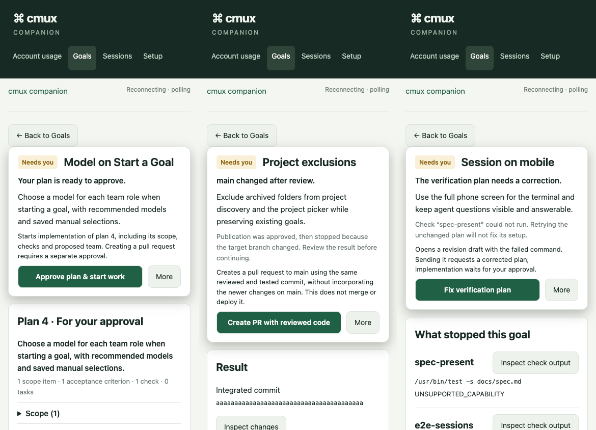
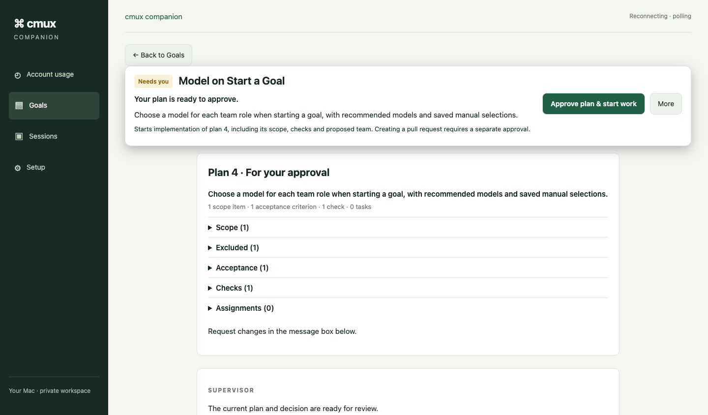

# Goal decisions and verification setup: delivery evidence

Owner: implementing agent, responsible for the UI, API projection, runner changes,
verification and cleanup. No delegation. Base: `3fb359a9`.

## Outcome and reviewed contract

The [spec correction](../superpowers/specs/2026-10-13-goal-decision-bar-design.md)
was committed as `da9bfc3f`. The user then replied “Reviewed — proceed with this
design”, before [the implementation plan](../superpowers/plans/2026-10-14-goal-decision-clarity.md)
was committed as `f50d1355`.

The current outcome and button consequence now appear at the top. The actions
distinguish approving implementation, creating a pull request, and publishing
reviewed code after the target branch moves. Current proposal/result precedes a
closed conversation history; the latest message remains visible. Publication
shows the result before the approved plan and expandable review/check evidence.

Failed checks name their approved command and failure code beside their output
control. An unsupported planned command offers **Fix verification plan**, which
opens a prefilled revision composer. Sending it requests a new reviewed plan;
opening it does not submit a command. Paused recovery, uncertain workers and open
clarifications keep their existing priority. Recovery remains available through
the secondary actions when the domain allows it.

The runner preserves the resolved environment's CI value instead of forcing
`CI=true` for local checks. Missing-executable diagnostics survive in immutable
evidence and the authenticated evidence APIs even when no process started.

## Reported goals: read-only findings

These observations came from the installed state at the start of this task;
they are not claims about later live progress.

| Goal | What the decision means / why it stopped |
| --- | --- |
| `b4efd4f2` — Model on Start a Goal | Revision 4 awaited approval. Approval starts the three-task plan for model recommendations and manual role selections. Previous attempts had exhausted their output budget. |
| `ba689fe4` — Start a goal - List of Projects | Publication had already been approved; `main` then advanced. Continuing creates the project-exclusions PR using the unchanged reviewed commit `b6b8db88d70c4fee766e73797b826cbe78e13c3c`, without merging or deploying it. Six planned checks and independent integration review had passed. |
| `6cdb5464` — Session in mobil | Recovery had run, with six actions remaining. `spec-present` used `/usr/bin/test`, absent on this Mac; `/bin/test` exists. `e2e-sessions` refused the runner's injected CI environment. `npm run verify` had passed at candidate `dfe93dead14cb2f3223d204303380f281b41a3ae`. Retrying the unchanged executable cannot repair the plan. |

The mobile goal still requires a reviewed plan revision correcting its executable.
No approved command was silently substituted. This branch does not approve,
recover, publish or otherwise mutate these three live goals.

## Boundaries

- **UI/API:** server-projected wording and check evidence drive both the list and
  detail; existing command types, exact revision/head payloads, version checks,
  pairing and authority are retained.
- **Storage:** verification artifacts gain an optional diagnostic message;
  existing artifacts remain readable. SQLite schema and historical approvals
  are unchanged. Both evidence routes bound the message to 4,000 characters.
- **Background execution:** direct argv execution, isolated HOME/XDG/temp,
  approved checkout checks and process ownership fencing are retained. Real CI
  still refuses the local-only Cypress command, as covered by runner tests.
- **External systems:** GitHub publication semantics, native adapter accounts,
  installed service and updater were not changed. Worker scaffolding is unrelated.

## Verification

All commands used Node `22.23.1` and the existing npm lockfile.

| Check | Result |
| --- | --- |
| `npm run verify` | Passed: 1,217 backend tests, 1 skipped; 262 UI tests across 28 files; backend line coverage 97.73%, UI line coverage 95.70%; lint, types and production build passed. |
| `npm run test:mac` | Passed, 106/106. |
| Focused backend after final decision guards | Passed, 62/62: `goal-verification`, `orchestration-verification`, `orchestration-decision-view`, `orchestration-api`. |
| Focused UI | Passed, 25/25 across decision bar, conversation, goal page and check evidence; layout-related tests were also rerun after the final markup adjustment. |
| Final lint/type checks and production build | Passed after the browser-test corrections; build repeated for the final layout. |
| Full local Cypress discovery | Initial run: 80 passed, 6 failed, 9 pending across 18 specs. Every failing spec was corrected and rerun as described below. Opt-in pending suites were not counted as passes. |
| Corrected deterministic suites | `goals-list`: 8/8; `goals-navigation`: 3/3; `pairing`: 9/9. |
| Decision layouts | `goal-workspace`: 7/7, including three scenarios at 390px and 1440px, 32 saved messages, two failed checks in the setup scenario, closed history, visible initial CTA/consequence, no horizontal overflow and page height below 2,000px. |
| Disposable real-service Cypress | `orchestration-core`: 3/3 writable journeys; `orchestration-conversation`: 1/1. Covers approval, recovery, checks/repair budgets, target movement, publication identity, review-fix checks, conflict repair and abort. One read-only variant remains pending. |

Reproduction commands for the browser checks:

```sh
CMUX_COMPANION_CYPRESS_BROWSER=chrome CMUX_COMPANION_CYPRESS_PORT=3239 npm run test:e2e:local
CMUX_COMPANION_CYPRESS_BROWSER=chrome CMUX_COMPANION_CYPRESS_PORT=3239 npm run test:e2e:local -- --spec cypress/e2e/goal-workspace.cy.ts,cypress/e2e/goals-list.cy.ts,cypress/e2e/goals-navigation.cy.ts,cypress/e2e/pairing.cy.ts
CMUX_COMPANION_CYPRESS_BROWSER=chrome CMUX_COMPANION_CYPRESS_PORT=3240 npm run test:e2e:local -- --orchestration --spec cypress/e2e/orchestration-conversation.cy.ts,cypress/e2e/orchestration-core.cy.ts
```

## Failures investigated and interventions

- A new resolver fixture renamed its check without updating the acceptance
  criterion reference. Corrected the fixture and reran the resolver/backend checks.
- Existing result assertions searched inside newly collapsed evidence; browser
  journeys now open the disclosure before inspecting it. Historical messages and
  superseded proposals are inspected through Conversation history.
- Navigation fixtures assumed `/` was Goals, although it now opens account
  usage. They now visit `/orchestration`. Offline recovery also stubs the supervisor
  lookup, and logout stubs the unpaired account-usage endpoint.
- A review-fix assertion expected merge-sync state to remain absent after push.
  The scheduler can already have made a new observation. The test now permits
  only a healthy open observation made after the successful round settled; the
  domain test still asserts that the push clears the previous observation.
- One conversation retry clicked an approval using a browser snapshot older than
  the settled supervisor, correctly receiving HTTP 409. The journey now reloads
  the settled state before approval; approval's no-auto-rebase behavior is unchanged.
- Phone height checks caught an irrelevant new-goal setup banner and excessive
  spacing. The banner now appears on the fleet only. Check names and their output
  controls share a row, and the approved plan no longer repeats its approval
  status below the heading. The stricter two-failure fixture initially measured
  2,033px; the final layout passes the original 2,000px requirement.

No coverage thresholds, safety assertions or approval gates were weakened.
Unchanged passing browser specs were not repeatedly rerun; the report retains
the initial full-suite failures instead of claiming a single green full run.

## Visual evidence and remaining limits

These are deterministic replays of the reported states, using disposable data,
not screenshots of modified live goals. First viewports were visually inspected.





Browser harnesses owned and cleaned up their disposable services and Git
repositories. No unrelated session or service was stopped. No native live suite,
installed-service restart, merge, release, account modification or live goal
mutation was performed. A draft PR is the delivery boundary; CodeRabbit review
and remote CI are separate from the local evidence above.

The fixes will affect the reported URLs only after an authorized release/install.
The mobile goal's immutable command additionally needs its reviewed revision;
this work does not claim that goal has recovered or completed.
